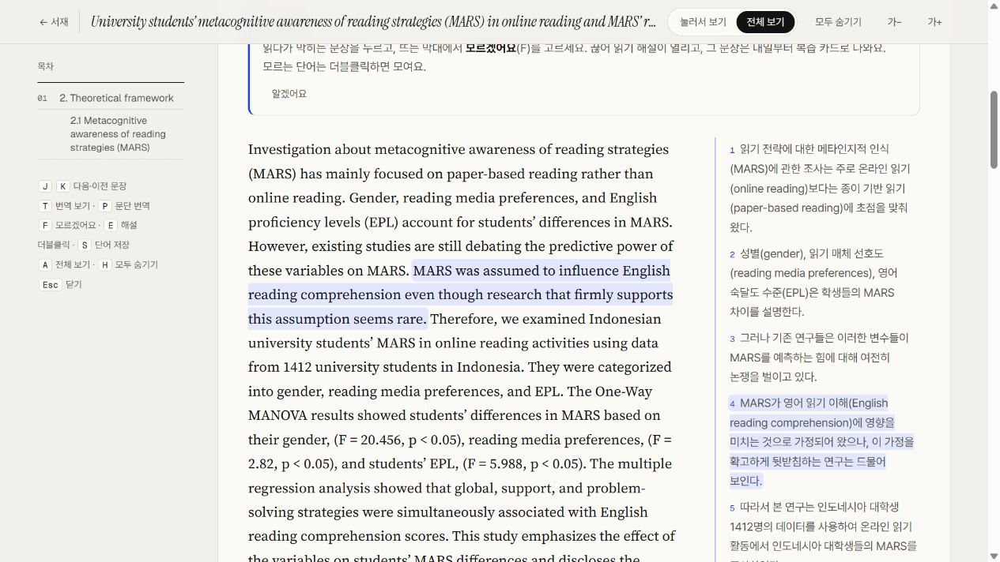

# 영어 읽기 코치

**영어 글을 읽다 막힌 부분을 확인하고, 모은 단어와 문장을 다시 복습하는 도구입니다.**

논문이나 뉴스를 읽으면서 해설과 복습을 한 흐름 안에서 이용할 수 있도록 만들었습니다. 개인 학습을 위해 제작한 브라우저 앱입니다.

**[설정 없이 샘플 보기 →](https://poby-ya.github.io/reading-coach/#/read/sample-paper-mars)** · [앱 열기](https://poby-ya.github.io/reading-coach/)

*샘플에는 미리 만든 번역과 해설이 담겨 있습니다. 새 문서의 번역·해설을 생성할 때는 본인의 API 키와 사용량이 필요합니다.*

## 어떤 기능을 만들었나요?

- **문장별 읽기:** 막힌 문장을 골라 끊어 읽기 해설을 확인합니다.
- **단어·문장 모으기:** 읽다가 만난 단어와 문장을 저장합니다.
- **간격을 둔 복습:** 모은 내용을 복습 카드로 다시 확인합니다.
- **기록 관리:** 읽기 기록을 브라우저에 저장하고 백업·복원할 수 있습니다.

## 제가 맡은 역할

읽기 중 막히는 순간과 복습으로 이어지는 과정을 정의했습니다. AI와 함께 화면과 기능을 구현하고, 직접 사용하면서 결과와 동작을 확인하며 개선했습니다.

읽기·저장·복습이 이어지도록 구성하고, 사용할 때 필요한 설정과 기록의 저장 위치를 안내하는 데 신경 썼습니다.

## 샘플은 이렇게 보세요

1. [논문 샘플](https://poby-ya.github.io/reading-coach/#/read/sample-paper-mars)을 엽니다.
2. 화면 위의 **전체 보기**를 선택하면 원문과 번역을 함께 볼 수 있습니다.
3. 문장을 선택하고 **모르겠어요**를 눌러 미리 만들어진 해설을 살펴봅니다.

짧은 글은 [뉴스 샘플](https://poby-ya.github.io/reading-coach/#/read/sample-news-arctic)에서 볼 수 있습니다.

## 사용 조건과 공개 범위

기록은 사용하는 브라우저에 저장됩니다. 새 번역과 해설은 각자의 키로 Claude API를 호출해 생성하며, 영영 뜻은 위키낱말사전(Wiktionary, CC BY-SA)에서 가져옵니다. 이 저장소에는 앱의 배포용 빌드 결과를 담았습니다.

## 샘플 글의 출처

- Anggia H, Habók A (2024). University students’ metacognitive awareness of reading strategies (MARS) in online reading and MARS’ role in their English reading comprehension. PLOS ONE 19(11): e0313254. https://doi.org/10.1371/journal.pone.0313254 — CC BY 4.0, 초록·서론 발췌. 위 화면 미리보기도 해당 샘플을 사용했습니다.
- NASA Earth Observatory (2026-10-07). Arctic Sea Ice Shrinks to Its 2026 Minimum. https://science.nasa.gov/earth/earth-observatory/arctic-sea-ice-shrinks-to-its-2026-minimum/ — 본문 발췌.
- 한국어 번역과 끊어 읽기 해설은 앱이 Claude로 만들었습니다.

[← 최광빈의 전체 프로젝트 보기](https://github.com/Poby-ya)
